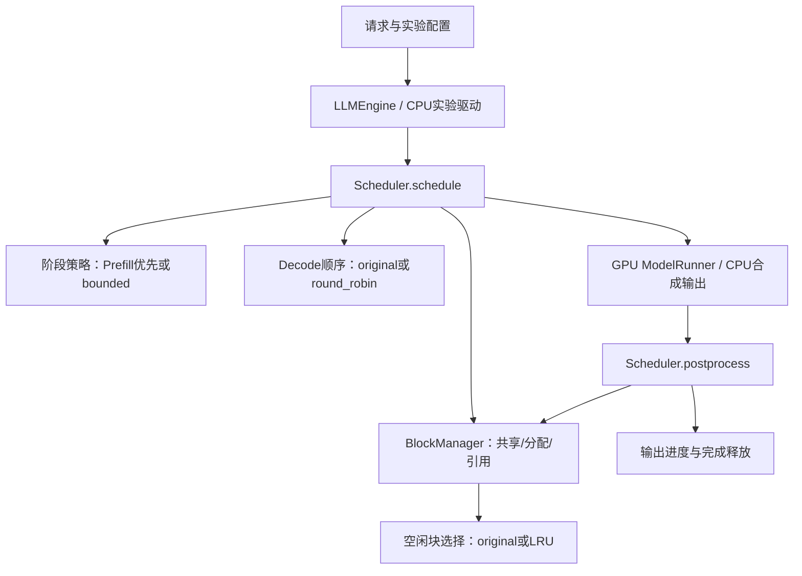

# 项目讲解与简历初稿

项目名称建议：nano-vLLM 调度与 KV 缓存策略实验。
一个项目包含NanoSched和CacheLab两个模块，不拆成两段独立项目经历。
技术栈：Python、PyTorch、CUDA/WSL2、Triton/FlashAttention集成、pytest。
不把使用已有kernel写成自行实现FlashAttention或底层CUDA kernel优化。

## 三条简历描述初稿

- 基于固定版本nano-vLLM扩展bounded_prefill阶段让行与Decode round_robin，
  分离阶段选择和请求顺序，补充容量、上下文长度和结果处理边界检查。
- 抽象KV缓存回收接口，实现按成功取得块引用时间排序的LRU；
  验证共享引用、前缀哈希链、覆盖及抢占恢复，在热点/扫描负载中记录相同命中与退化案例。
- 构建CPU回归与可复现实验，在WSL2/RTX 5060上通过八种单卡eager组合smoke；
  Qwen3-0.6B受控负载中，A首次Decode耗时中位数590.73→101.73ms，
  同时B最大首token等待466.66→639.61ms，明确记录调度取舍。

这是内容初稿，不强制在一页简历保留全部数字。按实际参与方式陈述工作，
能解释关键实现与复现实验后再使用，不宣称独立从零编写整个引擎。
代码由助手协作修改，用户亲手运行和参与理解验收；不能在被问到协作方式时虚构独立实现过程。

## 约一分钟讲解

我基于固定版本nano-vLLM研究调度等待和KV缓存回收。原版Prefill优先时，
持续新请求可能推迟已有请求的Decode；Decode批次受限时，队列也可能偏向前部请求。
项目分别用bounded_prefill限制连续Prefill批次数，用round_robin轮转Decode请求。

缓存部分保留原有共享和前缀机制，新增策略接口，以及按成功取得引用时间排序的LRU，
只回收空闲块，引用与哈希安全仍由BlockManager负责。
我通过真实管理代码的CPU回归、固定负载实验，以及本地GPU小规模运行验证这些修改。

结果体现取舍：GPU受控负载中A首次Decode提前，但B首token等待增加；
LRU在部分负载命中相同，还会在特定案例多算256个token。
我没有据此宣称整体吞吐提升，完整模型数值对照和更广压力测试仍待验证。

## 架构与调用链

图中两条执行路径互斥：CPU实验不调用GPU模型；GPU运行使用真实权重和kernel。
ModelRunner是上游已有执行器，不是本项目新写的模型架构。

## 上游与新增边界

| 机制 | 来源/本项目作用 |
|---|---|
| 模型实现、分块KV、前缀缓存、共享引用、抢占 | 上游已有；阅读、复用与补交互验证 |
| bounded_prefill与Decode round_robin | 新增可配置调度规则，保留原默认策略 |
| 回收策略接口与引用事件LRU | 新增，管理器仍负责安全边界 |
| CPU懒加载隔离、边界检查、实验与报告 | 项目新增/修改 |
| FlashAttention/Triton | 依赖并验证已有attention和写KV路径，不宣称独立设计kernel |

## 面试追问准备

1. 为什么不做混合Prefill/Decode？当前runner按阶段组织，先采用可控让行，混合批次重构暂缓。
2. 为什么LRU会退化？访问定义是取得引用，释放和attention读取不更新时间，
   与原版释放队列的选择可能不同，最旧块也可能是下一个请求需要的热点。
3. 82.8%是什么？指定受控负载中A首次Decode耗时中位数的降低，不是TTFT、整体延迟或吞吐提升。
4. GPU通过到什么程度？八组单卡eager小负载smoke和小规模attention参考对照；
   不等于完整模型数值参考、CUDA graph、多卡与所有缓存压力场景验证。
5. 如何复现？先看CPU_REPRO.md、GPU_TIMING.md，核对模型版本、配置、环境、源码指纹和原始样本。

数字和证据见 EXPERIMENT_RESULTS.md，最终分支提交与推送状态留到第二十单元核对。
